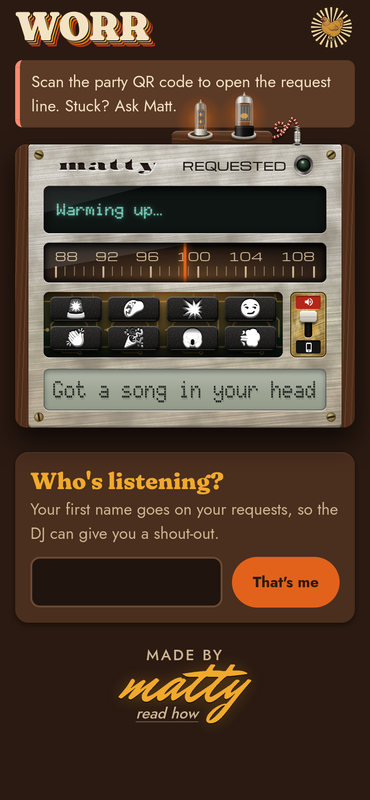

# WORR — a family-reunion radio station



A pretend 1970s FM station for one family party. Guests scan a QR code and pick a song on their phone. They add a
line for the DJ ("for Grandma, 50 years!"). A few minutes later, a DJ with a real voice reads it over the party
speakers and plays their song.

Between requests the station plays SomaFM's Seventies channel, so there is never dead air.

Built by Matt Williams with [Claude Code](https://claude.com/claude-code) in October 2026, for one family
reunion. It is a gift, not a product. It is shared so you can make your own.

<br clear="right">

## What a guest gets

- **A radio on their phone.** Search for a song, tap it, add a message. Each phone has two songs in the line at a
  time, and the line takes turns fairly, one phone at a time.
- **A DJ.** Claude writes each intro from the guest's message. ElevenLabs gives it a voice. The music dips under
  the voice and comes back up.
- **Jokes and announcements**, sent from the page and read at the next station break.
- **Sound buttons:** eight short clips, from an air horn to applause. They play on the party speakers or only on the phone, and the
  music dips a little to let them through.
- **Games.** Orrdle is a family Wordle. A scavenger hunt is hidden in the radio itself, and finding every medal earns a
  golden quarter: one more song.
- **The sleeve and the lyrics** of the song on air, live.

The host gets a booth page with:
- the line, and the requests held for a look;
- the guest list, with mute, kick, a free quarter, and Free Play for one phone;
- the sound pads;
- the station's health.

## How it fits together

```
guests' phones ──► Cloudflare Worker + one Durable Object (the queue: the single source of truth)
                        ▲ │  a heartbeat every ~3 s
                        │ ▼
a PC at home:      the studio (Python): finds and downloads each song, writes and voices the DJ's line
                        │  push / skip / status over the home network
                        ▼
a Raspberry Pi:    the console: SomaFM, two song decks, the DJ and the sound pads, mixed live ──► the PA
```

- **The queue lives in the cloud.** A Durable Object is a small database that lives inside one Cloudflare Worker. Every
  phone, the studio and the booth read and write the same line, so nobody disagrees about what's next.
- **The studio runs at home.** It turns a request into a song file and a voiced intro, then tells the Pi what to play.
- **The Pi is the mixing desk.** It plays four sources through one USB sound card and fades between them. If the
  studio goes quiet, SomaFM keeps playing.

Every layer has a fallback, so a failure costs polish, never silence:
- If ElevenLabs runs out, a free Cloudflare voice reads the line instead.
- If a download fails, the guest's request is marked failed and the next song plays.
- If the home PC drops off, the Pi stays on SomaFM.

| Folder | What lives there |
|---|---|
| `worker/` | The guest page (`public/index.html`), the booth (`public/admin.html`), the queue (`src/party.ts`) and its tests |
| `studio/` | Song search and download, the DJ's writer and voice, the break scheduler, and their tests |
| `pi/` | The console (`console.py`), its sound-card config, its service file and setup script |
| `tools/` | One-off makers (station IDs, jingles, sound pads, icons, the QR card), the party simulator, deploy and log helpers |
| `docs/` | Setup, the day-of checklist, hotfix rules, teardown, the code audit, the party-test reports |
| `spec.md` | What it had to do, and why |

## Services it uses

| Service | Job | Cost for one party |
|---|---|---|
| Cloudflare Workers Paid | the queue, the pages, a backup voice | $5 a month |
| Anthropic (Claude) | writes the DJ's lines; checks that a request is a real song | pay as you go; small for one night |
| ElevenLabs | the DJ's voice, the station IDs, the sung jingles | Starter plan or above |
| YouTube Data API | finds songs | free (about 100 searches a day) |
| Apify | downloads songs on its servers, so your home IP stays off YouTube's bot radar | about 2.5¢ a song |
| Apple search, LRCLIB | album, year, cover; lyrics | free |
| SomaFM Seventies | the music between requests, played as an ordinary listener | free ([please donate](https://somafm.com/support/)) |

## Make your own

Fork it and change the family:
- **The station name:** `MATTYFM_STATION_NAME`.
- **How the DJ says your names:** `studio/names.toml`.
- **The DJ's house rules:** `studio/mattyfm/djline.py`.
- **The Orrdle words:** `worker/src/party.ts`.
- **The domain:** `worker/wrangler.jsonc`.

Then follow [`docs/setup.md`](docs/setup.md). You'll need a PC that stays on, a Raspberry Pi with a USB sound card,
and the accounts above.

Before the party, read these:
- [`docs/party-test-2.md`](docs/party-test-2.md): four hours of a simulated full house.
- [`docs/day-of.md`](docs/day-of.md): the morning checklist.
- [`docs/hotfix.md`](docs/hotfix.md): how to fix things while guests are on the page.

```sh
.venv/bin/pytest studio/tests -q        # the studio's tests
cd worker && npx vitest run             # the queue's tests
cd worker && npx wrangler dev           # the guest page, locally
tools/hotfix.sh worker                  # deploy, then wait until the live queue runs the new code
```

Secrets live only in `~/.config/mattyfm/env` and in the Worker's secrets, never in this repo.

## Things learned the hard way

The [`CLAUDE.md`](CLAUDE.md) findings list holds them all. The ones most likely to bite you:
- **YouTube flags a home IP after about 50 downloads.** Search with the official API and download somewhere else.
- **SomaFM drops any listener whose software calls itself Liquidsoap** (its no-restreaming rule). Play it as an
  ordinary listener, and don't disguise the name.
- **Cloudflare bills every database row a query looks at,** not only the rows it returns. An unindexed poll took
  the queue down on the free plan in one day.
- **A deploy reaches a live Durable Object minutes later, not at once.** Read back a version marker; don't assume.
- **A "match score" is not a junk filter.** Real songs scored lower than "lol". Ask a model instead.

## How it was built

Claude Code wrote every line, from Matt's requests. Most requests were a screenshot and one sentence. Each change
went through the same loop:

1. Write the code.
2. Run the tests.
3. Check it in real browsers.
4. Review it for safety.
5. Deploy it quietly.

`CLAUDE.md` holds the working rules. [`docs/AUDIT.md`](docs/AUDIT.md) is the pre-party code audit. On the page, tap
"made by matty" for the story told for non-programmers.
